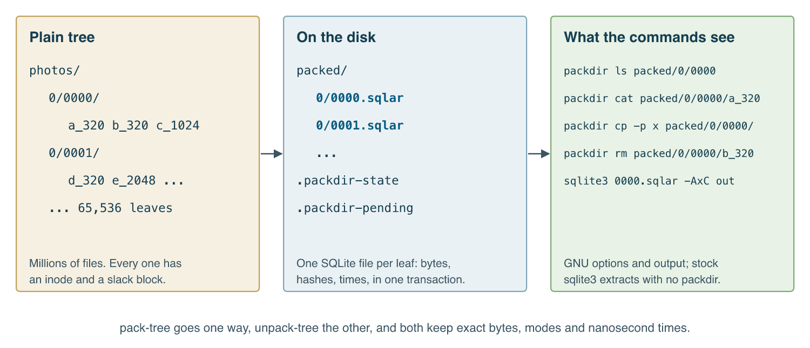
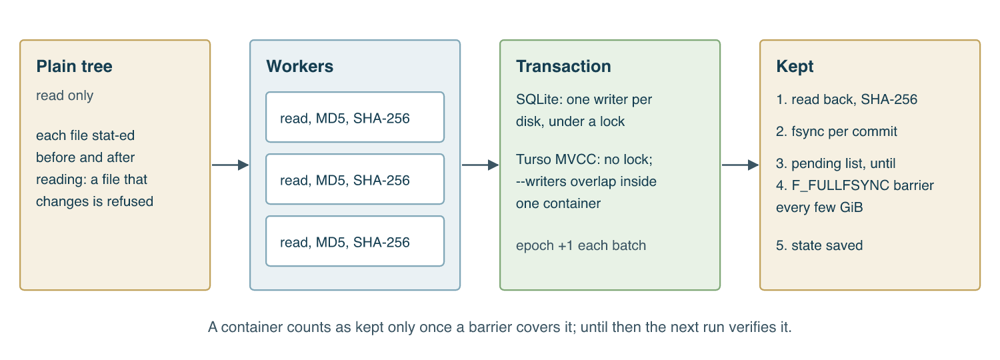
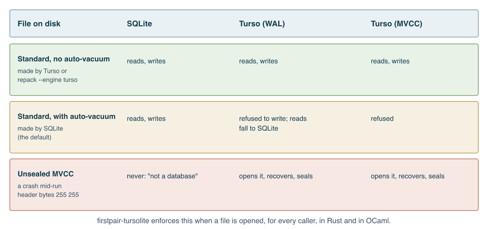

This post is by Alexy Khrabrov, with Claude as co-author. The ideas are Alexy's; Claude wrote the text and much of the code with him.

Small files are expensive. Each one costs an inode, a directory entry and a partly used block, and every tool that walks them pays again: a backup, a sync, even `rm -r`. On a spinning disk a million files can mean a million seeks.

The usual answer is an archive, and the usual price is that your files stop being files. You can't `ls` a tar file in any useful way, and you can't change one member in place. Zip is better at reading, but not at updating, and nothing commits atomically.

[packdir](https://github.com/querygraph/packdir) takes a different route. It keeps the files of a directory `D` as members of one SQLite archive, `D.sqlar`, and gives you the commands you already know to work on them.

```sh
packdir pack-tree photos packed --depth 2 --workers 4
packdir ls -lh packed/0/0000
packdir cat packed/0/0000/a_320 > a.jpg
packdir rm packed/0/0000/b_320
packdir du -sh packed
```

`ls`, `cat`, `stat`, `du`, `find`, `rm`, `cp`, `mv` and `mkdir` take GNU's options and print GNU's output. The test suite proves it: each command runs on a packed tree, GNU's runs on the same tree unpacked, and the two must agree.



## Why SQLite

SQLite already has an archive format. Its `sqlar` table holds a file's name, mode, time and bytes, and `sqlite3 D.sqlar -AxC D` extracts one with no other software. That matters more than it sounds. If packdir vanished tomorrow, your files would still be one standard command away.

On top of that sit a table of what a synchronizer or an integrity check needs (nanosecond times, SHA-256, retained deletions) and a counter that moves when a container changes. You also get what SQLite gives everyone: a transaction per batch, an index, and a file that survives a crash.

The rest is care about durability. On macOS, `fsync` doesn't empty the drive's own cache. Flushing it on every commit is slow, so packdir does what a careful backup does: `fsync` per transaction, one `F_FULLFSYNC` every few GiB, and a list of containers written since the last flush. After a power cut the next run verifies exactly those. A damaged container is set aside, never deleted, and packed again from the source.



## Why also Turso

[Turso](https://github.com/tursodatabase/turso) is a Rust rewrite of SQLite, and its headline feature is MVCC: writers that overlap in one file, where SQLite allows one at a time. For a tool built on writing many blobs, that's an obvious thing to want.

So packdir has a second engine, chosen per run:

```sh
packdir pack-tree photos packed --engine turso
packdir pack-tree photos packed --mvcc --workers 4
packdir pack-tree photos packed --mvcc --workers 4 --writers 2
```

The file format is shared, in principle. In practice, testing Turso 0.8.3 against stock SQLite turned up four sharp edges, and any one of them could have damaged an archive if taken on trust:

- **Auto-vacuum.** Turso won't normally write a file with it, and packdir's SQLite containers have it. An experimental flag lets Turso write anyway, and stock SQLite's integrity check then reported a broken freelist.
- **MVCC headers.** A file in MVCC mode has header bytes SQLite doesn't recognize. It answers "file is not a database".
- **No rollback journal.** Turso quietly ignores `journal_mode = DELETE`.
- **Reading changes bytes.** Opening a standard file with Turso rewrites its header, unless it's opened read-only.

The answer is a rule, enforced when a file is opened: Turso never writes a file with auto-vacuum, and everything Turso writes is **sealed** when it closes. Sealing checkpoints the file, takes it out of MVCC, and lets SQLite turn it back into a plain rollback-journal database. After a clean run, a Turso container is a file stock `sqlite3 -Ax` reads like any other. After a crash it stays unsealed until Turso next opens it, recovers and seals it.



Moving an existing SQLite tree to Turso is one command, `packdir repack --engine turso`, which rebuilds each container and verifies it before replacing the old one.

## What the concurrency buys

Here's a measurement that surprised us: a synthetic 1.60 GiB tree of 3,840 files in 64 containers, on an iMac Pro's internal SSD, with Turso 0.8.3. Each cell is seconds, averaged over two runs.

| Mode | OCaml | OxCaml | Rust |
| --- | --- | --- | --- |
| SQLite, 1 worker | 18.1 | 18.1 | 19.7 |
| SQLite, 4 workers | 5.8 | 5.7 | 6.6 |
| Turso, 4 workers | 8.9 | 8.5 | 10.6 |
| Turso MVCC, 4 workers | 7.7 | 7.9 | 9.2 |
| Turso MVCC, 1 worker, 4 writers | 18.8 | 19.3 | 25.1 |
| Turso MVCC, 4 workers, 2 writers | 6.8 | 6.7 | 7.9 |

Workers are what scale, because hashing is most of the work. Four workers on plain SQLite gave about a threefold gain, and that was the fastest row. MVCC beat Turso's own WAL mode, and adding writers helped it further, but it didn't catch SQLite here. Writers alone did nothing: four on one worker were no faster than a single SQLite writer, since commits to one file still go through one log. Rust ran 10 to 30 percent behind OCaml in this test, and OCaml and OxCaml were within noise of each other.

So SQLite stays the default, and MVCC is an option for the cases that fit it. We haven't measured it on a big tree on a spinning disk, and we don't want to guess. It's still real concurrency, tested hard: four writers on one file, a crash in the middle, and a different build of packdir recovering it.

One thing needed design rather than testing. Every committed batch bumps a counter, and in MVCC that one row becomes a conflict between every pair of writers. An early test logged 205 conflicts on the way to 40 commits. Under concurrent writers each batch now bumps it in its own short transaction, after its data.

## Rust, OCaml and OxCaml

packdir began in OCaml, and it builds with both stock OCaml 5 and OxCaml. It now has a second build in Rust, which is also a library any Rust project can use directly:

```rust
let c = Container::open("leaf.sqlar".as_ref(), &options)?;
let (stored, retained, bytes) = c.update(apply, &[], "plain/leaf")?;
let data = c.read("a_320")?;
c.close()?;
```

Each language has both engines. At the top of the range, Rust uses threads and OxCaml uses domains, each with its own connection, and the runtime lock is released around every statement. Stock OCaml 5 shares that code and passes the same tests. Where only standard SQLite will do, every build has it, and an OCaml build without Rust at all still works on SQLite alone.

"Equivalent" is an easy word, so the suite spells it out. Stock OCaml, OxCaml and Rust each pack a tree in each of four modes. Every other build must verify it, restore it exactly and carry on from its state. Stored tables must match in every combination, the file commands must print the same bytes, and a crash in one build must be recovered by another. That's 452 checks.

The suite earned its keep. Rust's bundled SQLite turns foreign keys on by default, and OCaml's doesn't, so a rename worked in one language and failed in the other. The state file began as an OCaml-only binary format. Both are fixed.

The database layer became its own package, [firstpair-tursolite](https://github.com/querygraph/tursolite): one interface over both engines, in both languages, with the rules above built in. DNG Compare, a photography tool, already uses it too.

## Where it came from

packdir was built for [Semantic Unison](https://firstpair.org/books/semantic-unison/), a fork of the Unison file synchronizer, to mirror a preview cache of 3.6 million files and about 4.5 TB onto a spinning HFS+ disk. There it became 65,536 containers, and Unison saw each one as the directory it replaced. On a 50 GiB test the first run took a quarter longer than copying plain files, and a rerun with nothing to do took 3.2 seconds.

That job taught a lesson worth passing on. The mirror slowed by a quarter part way through. It wasn't either disk: the workers were busy marking a 6.5 GB heap they had inherited through `fork` and would never use. A one-line change to the collector's settings in the child cut that cost about fourfold in a test.

But nothing in packdir needs Unison. If you have a tree of small files, try it on a copy:

```sh
packdir pack-tree mytree packed
packdir verify packed/*/*.sqlar
packdir unpack-tree packed check
diff -r mytree check
```

The [manual](https://firstpair.org/books/packdir/) has the rest: every command, the format, the engine rules, and what isn't known yet. packdir is Apache 2.0, at [github.com/querygraph/packdir](https://github.com/querygraph/packdir).
