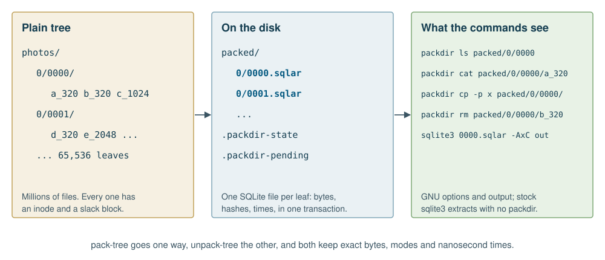
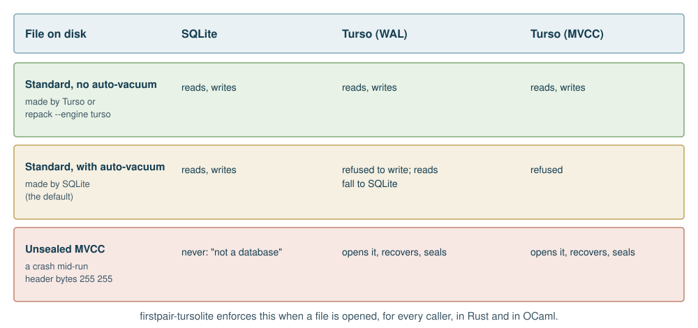
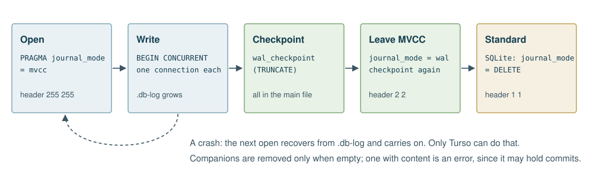
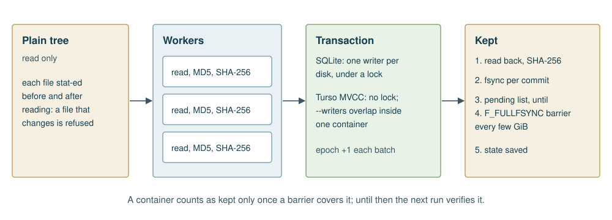

# About this manual

This manual is by Alexy Khrabrov, with Claude as co-author. The ideas and decisions are Alexy's; Claude wrote the text and much of the code with him.

It describes packdir as of 2026-11-01. Three kinds of statement appear below, and they are kept apart:

- **Measured** figures come with the conditions under which they were taken.
- **Estimates** are marked as estimates.
- **Unknown** things are said to be unknown.

packdir is licensed under the Apache License 2.0, and so is firstpair-tursolite, the database layer it shares with other projects.

# What packdir is

A directory of small files is an expensive thing to keep. Every file costs an inode, a directory entry and a partly used disk block. Copying a million of them means a million opens, and on a spinning disk a million seeks. Backups, synchronizers and `rm -r` all pay that price again, however little the data has changed.

The usual answer is an archive, and the usual price of an archive is that you can no longer use the files. A `tar` file has no index and cannot change in place. A zip file can be read at random, but updating one rewrites the central directory, and nothing commits atomically.

packdir keeps the files of a directory `D` as members of one SQLite archive, `D.sqlar`. That gives you the following:

- **Fewer files.** A tree of millions of small files becomes a few thousand files on disk, at a depth you choose.
- **Plain use.** `packdir ls`, `cat`, `stat`, `du`, `find`, `rm`, `cp`, `mv` and `mkdir` treat a packed tree as ordinary files, with GNU's options and GNU's output.
- **In-place updates.** Changing one member is one transaction. The rest of the container is not rewritten.
- **Whole-file safety.** Each batch commits or does not. Every member has a SHA-256, read back after writing.
- **Standard format.** `sqlite3 D.sqlar -AxC D` extracts the files with no packdir installed.



packdir comes in two builds that behave the same: one in OCaml, which also builds with OxCaml, and one in Rust. Each can be used as a command or as a library. Each stores containers with either of two engines, SQLite or Turso. Containers written by any combination can be read by any other, and stock `sqlite3` can read them all.

## Where it fits

This book is one of nine on the FirstPair photo tools. Each owns one part, and
[The FirstPair Photo Stack](https://firstpair.org/books/photostack/) shows how they fit together.

- **[tiffgraph](https://firstpair.org/books/tiffgraph/)** walks a TIFF or DNG file's structure under a fixed grammar and finds its editable XMP packet.
- **[phidentify](https://firstpair.org/books/phidentify/)** computes a photo's identities: SHA-256, DNG raw blocks, image data, block marks, Lightroom fingerprint, metadata record and preserved digest, and the skeleton that rebuilds a file from an edited copy.
- **[phindex](https://firstpair.org/books/phindex/)** keeps those identities and a skeleton for every file of a volume, aligns two volumes by content, and restores a file as it was before a metadata edit.
- **[DNG Compare](https://firstpair.org/books/dng-compare/)** compares pairs and preserves one side byte for byte as deltas against the other, restorable even after the other side is edited, with a searchable metadata section, through `dngc`.
- **[Semantic Unison](https://firstpair.org/books/semantic-unison/)** synchronizes photo trees, sending metadata edits without resending image bytes, keeps the versions it replaces as small skeletons, and preserves what a shuttle disk brings into the same archives.
- **[packdir](https://firstpair.org/books/packdir/)** keeps directories of small files as SQLite archives that still work like plain files.
- **[Tursolite](https://firstpair.org/books/tursolite/)** is the SQLite and Turso layer under packdir, DNG Compare and Mechanic.
- **[diskproxy](https://firstpair.org/books/diskproxy/)** serves a folder as a virtual disk, such as previews with camera metadata spliced in, and captures ratings into sidecars.
- **[Lightroom Repair](https://firstpair.org/books/lightroom-repair/)** repairs Lightroom Classic catalogs, previews and Sync without forging their state.

## When to use it

packdir suits data that is many small files, read whole, and rarely rewritten: preview and thumbnail caches, image tiles, document collections, build outputs and scraped pages. It suits slow disks and old file systems especially, because small-file overhead hurts most there.

It does not suit files a program must open directly with ordinary system calls, because a member has no path the kernel can see. It does not suit large files either: a member is held in memory while it is stored. It offers no compression, by design: `sz` always equals the length of `data`, which keeps the format simple and is the right choice for already compressed data such as JPEG.

# Getting started

Pack a tree, look inside it, and get it back:

```sh
packdir pack-tree photos packed --depth 2 --workers 4
packdir ls -l packed/0/0000
packdir cat packed/0/0000/a_320 > a.jpg
packdir verify packed/0/*.sqlar
packdir unpack-tree packed restored
```

`--depth 2` means every directory two levels under `photos` becomes one container, so `photos/0/0000/` becomes `packed/0/0000.sqlar`. Choose a depth whose directories hold tens to thousands of files each. Files above that depth are not packed.

Run `pack-tree` again later and it stores only what changed:

```sh
packdir pack-tree photos packed --depth 2 --workers 4
```

Each run ends with one line of JSON giving what it did: containers, how many it opened, files stored and retained, bytes, seconds and rates. Files that have gone from `photos` are not deleted from the container. They are marked **retained**, and `unpack-tree --skip-retained` leaves them out, or `repack --drop-retained` removes them for good.

To check an archive with no packdir at all:

```sh
mkdir out && sqlite3 packed/0/0000.sqlar -AxC out
```

That restores bytes and modes, with times to the second. `packdir restore` and `unpack-tree` restore nanosecond times.

## Building it

The repository is [github.com/querygraph/packdir](https://github.com/querygraph/packdir). The database layer, firstpair-tursolite, is a separate project at [github.com/querygraph/tursolite](https://github.com/querygraph/tursolite).

**OCaml or OxCaml.** Turso's C library comes from Rust, and opam's build sandbox allows no cargo, so build it first. The sequence is the same in a stock OCaml 5 switch and an OxCaml switch:

```sh
git clone https://github.com/querygraph/tursolite ../tursolite
make -C ../tursolite sdk
opam pin add firstpair-tursolite-sdk ../tursolite
opam pin add firstpair-tursolite ../tursolite
opam pin add packdir .
```

Leave out the SDK and packdir still builds, on SQLite alone. A request for Turso then says the build does not link it.

**Rust.**

```sh
cd rust && cargo build --release
```

Both engines are in by default. The features are `sqlite` and `turso`, so a project can link only the one it wants.

# Commands

## Tree commands

```sh
packdir pack-tree ROOT OUT [--depth N] [--workers N] [--wal] [--batch-mib M] [--barrier-gib G]
                           [--engine sqlite|turso] [--mvcc] [--writers N]
packdir unpack-tree OUT DEST [--skip-retained]
packdir repack C.sqlar... [--drop-retained] [--engine sqlite|turso]
packdir verify C.sqlar...
packdir list C.sqlar
packdir restore C.sqlar OUT_DIR [--skip-retained]
```

**`pack-tree`** keeps every directory `--depth` levels under `ROOT` (default 2) as `OUT/<rel>.sqlar`. A rerun compares size and nanosecond mtime, stores what is new or changed, and marks what has gone as retained. A container whose file is as recorded after the last run is not opened at all, so a rerun over an unchanged tree only reads directories.

A plain directory already in `OUT` beside a container is left alone. A file in it with the same bytes as the source is not packed; one that differs is stored in the container, and the plain file stays as it was.

**`unpack-tree`** turns every container back into a plain tree, with exact bytes, modes and nanosecond mtimes. It never overwrites a file.

**`repack`** rebuilds a container compactly, verifying the old one first and the new one after, and flushing it to the platter before it replaces the old one. A crash leaves one or the other whole. It can drop retained members, and with `--engine turso` it gives a container made by SQLite the form Turso can write. A leftover `.repack` file from an interrupted run is refused, never overwritten.

**`verify`** runs `PRAGMA integrity_check`, then checks every member's SHA-256 and MD5 and that the two tables pair up. A missing container is an error, never created.

**`list`** prints each member's name, size, nanosecond mtime and SHA-256, marked `retained` where it applies.

**`restore`** unpacks one container.

The options that matter most:

| Option | Default | Meaning |
| --- | --- | --- |
| `--workers N` | 1 | Containers prepared at once. Processes in OCaml, threads in Rust |
| `--writers N` | 1 | With `--mvcc`, transactions overlapping inside one container |
| `--engine` | `sqlite` | `sqlite` or `turso`. `PACKDIR_ENGINE` sets the default for every command |
| `--mvcc` | off | Turso's concurrent transactions, with no writer lock between containers. Implies Turso |
| `--wal` | off | WAL instead of a rollback journal, for comparison |
| `--batch-mib M` | 256 | Largest transaction, in MiB of member data |
| `--barrier-gib G` | 4 | Data written between drive-cache flushes |

## File commands

These see a packed tree as plain files. A path `ROOT/A/B/name` reads through `ROOT/A/B.sqlar`, and a member wins over a plain file of the same name beside its container.

| Command | Options |
| --- | --- |
| `ls` | `-l -1 -a -A -h -R -r -t -S -U -d -g -n`, `--full-time`, `--sort=`, `--time-style=full-iso`, and `--retained` to show retained members |
| `cat` | `-n -b`, `-` for standard input |
| `stat` | `-c FORMAT`, `--printf FORMAT`: `%n %s %a %A %y %Y %F %U %G %u %g %h`, with widths such as `%04a` |
| `du` | `-a -b -s -h -c -d N`; sizes are apparent sizes, as with GNU's `--apparent-size` |
| `find` | `-name GLOB -type f\|d\|l -maxdepth N -mindepth N` |
| `rm` | `-f -r -R -d -v` |
| `cp` | `-p -a -r -R -n -v -t DIR` |
| `mv` | `-n -v -t DIR`; renames inside a container, otherwise copies then removes |
| `mkdir` | `-p -v`, and `--packed` to start an empty container |

Output, exit codes and messages follow GNU coreutils 9 under `LC_ALL=C`. The test suite proves this by running each command on a packed tree and GNU's on the same tree unpacked, and comparing them. A few things cannot match: the `total` line and directory lines of `ls -l`, directory sizes in `du`, and the order of `du` and `find`, which is sorted here.

`rm`, `mv` and `cp` into a container change it in one transaction. Don't run them while another program writes the same tree.

`mkdir` makes a plain directory, as GNU's does. A member cannot hold a directory, so `mkdir` inside a packed directory fails with "Not a directory". `packdir mkdir --packed box` makes `box.sqlar`, and files copied into `box/` become members:

```sh
packdir mkdir --packed box
packdir cp -p report.pdf box/
packdir ls -l box
```

# The container format

A container is an ordinary SQLite database. These are its tables:

```sql
CREATE TABLE sqlar(name TEXT PRIMARY KEY, mode INT, mtime INT, sz INT, data BLOB);
CREATE TABLE unison_member(name TEXT PRIMARY KEY REFERENCES sqlar(name),
  mtime_ns INT NOT NULL, fp BLOB NOT NULL, fpalg TEXT NOT NULL, sha256 BLOB NOT NULL,
  retained_deleted INT NOT NULL DEFAULT 0);
CREATE TABLE unison_container(key TEXT PRIMARY KEY, value TEXT);
```

`sqlar` is SQLite's own archive table, which is why stock tools can read a container. The other two hold what an archive of this kind needs and `sqlar` lacks: nanosecond times, hashes and retained deletions. Their names recall the project packdir was first written for. They are part of the on-disk format, and they stay.

- `page_size` is 65536, so a typical member takes few pages.
- Blobs are raw, so `sz` is the length of `data`. SQLite's archive tool would call this an uncompressed member.
- `sha256` holds lower-case hex text. `fp` holds the raw MD5, with `fpalg` set to `unison-md5/1`.
- `unison_container` holds `format`, which is `unison-packdir/1`, or `unison-packdir/2` when the container holds clones (see the next chapter), and `epoch`, a counter bumped by committed changes. Another program can compare the epoch to notice that a container changed.

Containers SQLite creates have `auto_vacuum = INCREMENTAL` and `journal_mode = DELETE`, so nothing is left beside them between transactions. Containers Turso creates have no auto-vacuum, for the reason given in the next chapter. That is the only stored difference between them. The members, the hashes and the bytes are the same.

Beside the containers, `OUT` holds three files of packdir's own:

- `.packdir-state`: for each container, its file's identity after the last run and its members then. It is a small text format that both builds share. Losing it costs one full re-read.
- `.packdir-pending`: containers written since the last barrier.
- `.packdir-writer.lock`: the writer lock.

# Clones

On APFS, `cp -c` and Finder's Duplicate make a **clone**: a second file that shares the first one's blocks until either is written. A plain copy loses that. Each clone becomes a full copy, and the space doubles. Photo libraries are full of them: one application's previews cloned into another's folder, or the same preview shared by two catalogs.

`pack-tree --clones` keeps them. Before packing, it reads each file's APFS clone ID and refcount. Files in the tree that share a clone ID, with a refcount above 1, form a group:

- **One member of each group holds the bytes:** the first that is already packed, or else the first in path order.
- **Every other member is a reference to it,** in its own container or another. A reference costs a row, not a copy.
- **Files with identical bytes that were not clones stay separate.** Only real clones are kept as clones.

```sh
packdir pack-tree photos packed --clones
```

`unpack-tree` puts them back as clones. It restores every file that holds data first. Then it makes each clone with `clonefile` from its original's restored file and gives it the clone's own mode and mtime. Its summary line counts both:

```text
{"containers": 3, "files": 7, "cloned": 3, "copied": 0}
```

A clone whose original wasn't restored in the same run, or whose destination can't clone (another volume, a file system other than APFS, another system), gets its original's bytes instead, and counts as copied. `restore` of a single container does the same: clones within that container are cloned, and clones of members elsewhere are copied.

## How clones are stored

A container with clones has two more tables:

```sql
CREATE TABLE packdir_clone(name TEXT PRIMARY KEY, mode INT, mtime INT, sz INT,
  original TEXT NOT NULL, sha256 BLOB NOT NULL);
CREATE TABLE packdir_cloned_by(name TEXT NOT NULL, clone TEXT NOT NULL,
  PRIMARY KEY (name, clone));
```

- **A clone has a `packdir_clone` row and no `sqlar` row.** `original` is the path of its original relative to the container's directory, for example `../../lr/0000/a_320`. Its `unison_member` row is as for any member, so the packed view, `ls`, `stat`, `du`, `find` and Semantic Unison see an ordinary file. `cat` and `cp` read the original's bytes and check the SHA-256.
- **The original's container lists its clones** in `packdir_cloned_by`. Before anything changes or removes an original, its clones get its bytes as `sqlar` rows of their own. That covers a new version stored by `pack-tree`, `rm`, `repack --drop-retained`, and a clone whose source file stopped being a clone. `mv` of an original rewrites its clones' references instead. A deleted original kept as retained keeps its bytes, so its clones still read.
- **The format becomes `unison-packdir/2`** in any container with clone rows or back-references. Builds from before clones refuse such a container instead of missing its clones. Containers without clones stay `unison-packdir/1`.
- **`verify` checks every clone:** its member row, that it holds no data of its own, and that its original exists and has the same SHA-256.

## Without packdir

A clone has no row in `sqlar`, so `sqlite3 -Ax` extracts every other member and skips it. This is deliberate: a member with no data would make `sqlite3 -Ax` stop with "error in uncompress()" and extract nothing after it. After extracting each container `D.sqlar` into `D/`, stock tools bring the clones back:

```sh
cd D
sqlite3 -separator $'\t' ../D.sqlar "SELECT original, name, mtime FROM packdir_clone" |
while IFS=$'\t' read -r original name mtime; do
  cp -c "$original" "$name" && touch -t "$(date -r "$mtime" +%Y%m%d%H%M.%S)" "$name"
done
```

`cp -c` makes a clone where it can and copies otherwise.

# SQLite and Turso

packdir stores containers with one of two engines, chosen per run. They offer different things:

| | SQLite | Turso |
| --- | --- | --- |
| What it is | The standard embedded database | A Rust rewrite of SQLite, in process |
| Maturity | Decades of production use | Young; moving quickly |
| Journal | Rollback journal or WAL | WAL, or its own MVCC log |
| Writers in one file | One at a time | With MVCC, overlapping transactions |
| Auto-vacuum | Yes | Experimental, and not safe here |
| Stock tools read its files | Yes | After sealing, yes |

Turso reads and writes SQLite's file format, but not every file in every state, and the differences have consequences. Each rule below came from testing Turso 0.8.3 against stock SQLite, and firstpair-tursolite enforces them when a file is opened, for every caller.



**Turso does not write a file with auto-vacuum.** Without the experimental flag it opens such a file read-only. With the flag, it wrote, and stock SQLite's `PRAGMA integrity_check` then reported freelist and pointer-map failures on the result (measured on 0.8.2 and 0.8.3). Turso under MVCC refused outright, though not before changing the header. So packdir refuses. A write to such a container with Turso stops with an error and changes nothing. Reads fall to SQLite, and `repack --engine turso` rebuilds a container without auto-vacuum, keeping every member.

**SQLite cannot open a file left in MVCC mode.** MVCC sets header bytes 18 and 19 to 255, and stock SQLite reports "file is not a database". So every file Turso writes is **sealed** when it closes.

**Turso has no rollback journal.** It ignores `journal_mode = DELETE`. So a Turso write works in WAL or MVCC, and sealing puts the standard form back.

**Opening a standard file with Turso changes its bytes**, because Turso turns the header to WAL on open. A read-only open does not. packdir opens with Turso read-only whenever it is only reading.

## Sealing



Closing a container Turso wrote takes four steps: checkpoint, leave MVCC, checkpoint again, and let SQLite return the file to a rollback journal. The empty `-wal` and `.db-log` files are removed. A companion with content in it is an error, because it may hold commits. So after a clean run a Turso container is a standard SQLite file, apart from having no auto-vacuum, and `sqlite3 -Ax` reads it like any other.

A crash leaves the file unsealed. That is safe, because Turso recovers from its log the next time the file is opened, and closing it seals it. Until then only Turso can open it, so a build without Turso says it needs Turso.

# Concurrency

Three different things can run at once, and they are easy to confuse:

- **Workers** prepare containers. A worker reads files, checks that they did not change while read, and hashes them. All of this happens outside any lock. This is where most of the CPU goes.
- **The writer lock** takes turns between containers. Under SQLite, only one transaction at a time goes to the disk, across all workers. On a spinning disk that keeps the head from fighting itself.
- **Writers**, with `--writers`, overlap inside one container. They exist only under Turso MVCC, because SQLite allows one writer per file.



`--mvcc` removes the writer lock. Containers are written side by side, and each commits with `BEGIN CONCURRENT`. `--writers N` splits one container's bytes into about N batches, written on N threads in Rust or N domains in OCaml, each with its own connection. A transaction that loses a conflict rolls back and runs again.

One row needs care. The epoch would be a conflict between every pair of concurrent transactions: an early test on four writers logged 205 conflicts on the way to 40 commits. So under concurrent writers each batch bumps the epoch in a short transaction of its own, after its data. A crash between the two leaves data committed with the epoch one behind. packdir's own recovery does not depend on the epoch: the pending list and the file's identity decide what is checked again.

## What it buys

Measured on 2026-11-01 on an iMac Pro with an Intel Xeon W-2191B, on its internal SSD, with Turso 0.8.3: a synthetic tree of 1.60 GiB in 3,840 incompressible files and 64 containers, packing into an empty directory, averaged over two runs. Each cell is seconds of wall-clock time.

| Mode | OCaml | OxCaml | Rust |
| --- | --- | --- | --- |
| SQLite, 1 worker | 18.1 | 18.1 | 19.7 |
| SQLite, 4 workers | 5.8 | 5.7 | 6.6 |
| Turso, 4 workers | 8.9 | 8.5 | 10.6 |
| Turso MVCC, 4 workers | 7.7 | 7.9 | 9.2 |
| Turso MVCC, 1 worker, 4 writers | 18.8 | 19.3 | 25.1 |
| Turso MVCC, 4 workers, 2 writers | 6.8 | 6.7 | 7.9 |

Four things stand out:

- **Workers are what scale.** Going from one worker to four on SQLite gives about a threefold gain, because hashing is the bulk of the work.
- **SQLite is ahead, and MVCC narrows the gap.** On this disk and this load, four workers on SQLite's plain writer lock were the fastest row. Within Turso, MVCC beat WAL by about 10 percent, and adding two writers per worker gained about as much again, which brought it within about 20 percent of SQLite.
- **Writers alone did not help.** Four writers on one worker were no faster than one SQLite writer. Commits to one file still go through one log, and with one worker the files of the next container wait for this one.
- **The languages are close.** OCaml and OxCaml were within noise of each other. Rust was 10 to 30 percent behind them, furthest behind on Turso with writers. Its advantage is elsewhere: threads rather than processes, and direct use from Rust programs.

So SQLite remains the default. MVCC is worth trying where its strengths apply: a fast disk, one very large container, or several writers that want to be independent, such as long-running services. **Unknown:** how MVCC behaves on a large tree on a spinning disk. It has not been measured, and the removal of the writer lock may hurt there, since it brings back seeks between containers.

## OxCaml, OCaml and Rust

The tier is the same on each language, and it is worth stating exactly:

| | SQLite | Turso | Turso MVCC with `--writers` |
| --- | --- | --- | --- |
| Rust | Yes | Yes | Threads, each with a connection |
| OxCaml | Yes | Yes | Domains, each with a connection |
| Stock OCaml 5 | Yes | Yes | Domains, each with a connection |

The binding is one C stub, and it releases the runtime lock around every statement step, so domains run in Turso in parallel. Stock OCaml 5 and OxCaml share it, and every test in this manual passes on both. Nothing in packdir yet uses OxCaml's own features, such as its data-race checks. It builds under OxCaml and benefits from its compiler. OxCaml marks `Domain.spawn` with two alerts, recommending its own threading library, and packdir acknowledges both and caps `--writers` at the recommended domain count.

Where only standard SQLite will do, every build has it: a system without a Rust toolchain, a stock OCaml build without the SDK, or a tree that other SQLite tools must also write.

## A note on fork

Using packdir as a library inside a larger OCaml program, you may be tempted to fork a worker per container, as the command line does. If the parent holds a large heap, tell the child's collector to stand down:

```ocaml
Gc.set { (Gc.get ()) with Gc.space_overhead = 1000000 }
```

A forked child inherits the parent's whole heap, and as it allocates file contents its major collector marks all of it, for nothing, since the child lives for one job. In one real run, marking took about four times the CPU of SHA-256 (a stack sample of a worker, 739 samples against 179), with a parent of 6.5 GB. In a synthetic test on a 3.7 GiB heap, that one line cut the child's CPU from 0.63 s to 0.16 s. Rust has no such cost, and neither does `pack-tree` itself, whose workers fork early from a small heap.

# Durability and recovery

packdir keeps these promises, in this order:

1. **Before storing**, a file is checked to be unchanged across its read: same inode, size, mtime and ctime. A file that changed is refused.
2. **After storing**, the changed blobs are read back from the container and their SHA-256 compared.
3. **Each transaction** is synced with `fsync` (`synchronous = FULL`). On macOS this does not reach the platter, because the drive keeps its own cache.
4. **Every `--barrier-gib`**, and at the end of a run, one `F_FULLFSYNC` empties the drive's cache for everything written so far.
5. **A container counts as kept only once a barrier covers it.** Each container joins `.packdir-pending` before its first write, and the list is cleared after the final barrier and state save.

Flushing the drive's cache at every commit would be far slower, and it is not needed. After a crash or a power loss, the next run verifies exactly the containers that might not have reached the platter, plus any whose file no longer matches `.packdir-state`.

A damaged container is never deleted. It is set aside as `D.sqlar.damaged-<time>`, reported, and the directory is packed again from the plain side.

The tests exercise this. An environment variable stops the process inside a transaction, in every engine and mode including concurrent writers, and the next run, in a different build of packdir, must verify, recover and carry on. Another test flips one byte inside a blob and expects `verify` to name the SHA-256 mismatch and the next run to set the container aside.

## Tuning

- `PACKDIR_SYNC=fullfsync` flushes the drive on every commit, and `normal` syncs less often. Both exist for benchmarks.
- Raise `--batch-mib` only if a directory holds very many large files. A batch is held in memory.
- Keep the `OUT` of a slow disk on one writer. The writer lock lives in `OUT`, so separate runs on one disk also take turns.

# Using packdir as a library

## From Rust

Add packdir as a dependency. Features choose the engines.

```toml
[dependencies]
packdir = { git = "https://github.com/querygraph/packdir" }
# or, without Turso:
# packdir = { git = "https://github.com/querygraph/packdir", default-features = false, features = ["sqlite"] }
```

Open a container, bring it up to date with a directory, and read a member:

```rust
use packdir::container::{Apply, Container, OpenOptions};
use packdir::tursolite::{Engine, Journal};

let options = OpenOptions {
    engine: Some(Engine::Turso),
    journal: Journal::Mvcc,
    ..OpenOptions::default()
};
let c = Container::open("leaf.sqlar".as_ref(), &options)?;
let apply = Apply { writers: 4, ..Apply::default() };
let (stored, retained, bytes) = c.update(apply, &[], "plain/leaf")?;
let data = c.read("a_320")?;
assert!(c.verify()?.is_empty());
c.close()?; // seals what Turso wrote
```

Call `close`. A container dropped without it is left as after a crash, for the next open to recover.

The crate also exports `container::repack`, `container::plan`, `container::barrier`, `cli::pack_tree` for a whole tree, and `tursolite`, the database layer.

## From OCaml and OxCaml

```ocaml
let c = Packdir.Container.open_ ~engine:Tursolite.Turso ~journal:Packdir.Container.Mvcc "leaf.sqlar" in
let stored, retained, bytes = Packdir.Container.update ~writers:4 c "plain/leaf" in
let data = Packdir.Container.read c "a_320" in
assert (Packdir.Container.verify c = []);
Packdir.Container.close c
```

`Packdir.Container` is the format, `Packdir.Fileutils` the file commands, `Packdir.Cli` the whole command line, and `Packdir.Native` the SHA-256, nanosecond `stat`, `utimensat` and `F_FULLFSYNC` calls.

## firstpair-tursolite

The database layer is its own package, because it has nothing to do with archives: [firstpair-tursolite](https://github.com/querygraph/tursolite), with its own manual, [tursolite](https://firstpair.org/books/tursolite/), on the same shelf. It offers one interface over SQLite and Turso, with the same shape in Rust, OCaml, OxCaml and Python: open a file with an engine and a journal, take one connection per thread or domain, run SQL, write in transactions that a lost MVCC conflict runs again, and close, which seals what Turso wrote so stock `sqlite3` reads it.

packdir relies on three of its guarantees. Under Turso's MVCC its workers write one container at once. `close` seals each container back to a standard SQLite file, so `sqlite3 D.sqlar -AxC D` works with no packdir installed. And the layer sets one rule where the engines differ: foreign keys are off on every SQLite connection, because the bundled SQLite in Rust turned them on and the system's did not, and one of packdir's renames worked in one language and failed in the other until then.

The same layer serves DNG Compare, whose archives stay in WAL between runs (`Keep_wal`, `Journal::Existing`), and Mechanic's EXIF stub store. The tursolite manual covers the interface, the engine rules and their limits.

# Three builds, one behaviour

"Equivalent" is easy to claim, so here is exactly how it is tested. The numbers below are the state of the suites on 2026-11-01.

- **`test/controls.py`** (92 checks) packs a tree in the layout of a preview cache and checks incremental runs, a crash inside a transaction, corruption, plain directories beside containers, repack and unpack. It restores with stock `sqlite3` as well as packdir.
- **`test/fileutils.py`** (58 checks) runs each file command on a packed tree, and GNU's on the same tree unpacked, and compares output, exit codes and messages.
- **`test/cross.py`** (452 checks) is the one that proves equivalence. Stock OCaml, OxCaml and Rust each pack a tree in each mode: SQLite, Turso, MVCC, and MVCC with writers. Every other build must then verify it, restore it exactly and carry on from its state with nothing to do. Stored tables must be the same in every combination, and the file commands must print the same. A crash in one build is recovered by another.
- **`tests/matrix.rs` and `ocaml/test/matrix.ml`** in firstpair-tursolite test each engine and journal, the guards between them, and concurrent writers losing nothing, in both languages.
- **`rust/tests/library.rs`** uses packdir as a Rust project would.

The controls and file suites pass on all three builds, on both engines, and the controls also under MVCC with concurrent writers, where the three checks for the plain WAL variant do not apply.

The suites found real differences on the way: the foreign-key default above, and SHA-256 speed, since the Rust crate's hash was slower than the system's on a CPU without SHA instructions, so on macOS Rust now uses the same system routine as OCaml. The shared `.packdir-state` also began as an OCaml-only binary format, which would have made every Rust run after an OCaml run start over.

One difference remains. **File names must be UTF-8 in the Rust build, and under Turso.** The OCaml build on SQLite treats names as bytes. macOS file systems do not allow anything else, so this only matters on Linux, and Rust reports such a name as an error rather than skipping the file.

# A use case: Semantic Unison

packdir began as part of [Semantic Unison](https://github.com/querygraph/semantic-unison), a fork of the Unison file synchronizer. The problem was a photo catalog's preview cache: 3.6 million small files and about 4.5 TB, to be mirrored onto a spinning HFS+ disk. HFS+ has no clones, so copying every small file meant writing every one, and each later comparison would have to walk them all.

Semantic Unison's **packed roots** use packdir as a library, and its `unison-packdir` command is packdir under another name. To Unison, a container looks like the directory it replaces: three hooks answer `stat`, directory listing and fingerprint from the member table, so update detection needs no change, and files are stored as members rather than copied into a temporary and renamed. Its archive plays the part `.packdir-state` plays here. The tree becomes 65,536 containers, 4,096 under each of its 16 top-level directories, averaging about 72 MiB. Files that must stay plain sit beside their containers untouched.

On a 50 GiB test set on that disk, Unison packed the tree in 424 s against 337 s for copying plain files with an empty target, and a rerun with nothing to do took 3.2 s. So packing cost about a quarter more on the first run, and it paid for itself in every run after that. Those runs used SQLite, whose writer lock suits one spinning disk. **Unknown:** the full mirror's total time. It was still running as this was written, at 100 to 135 MB/s.

That run is also where the note on fork came from. The mirror slowed by a quarter part way through, and the profile showed workers marking a heap they had inherited and would never use. packdir's design decisions held. The cost was in how it was being called.

Nothing in packdir needs Unison. The dependence runs the other way.

# Limits

- **Members are read into memory** while stored. A directory of huge files is the wrong shape.
- **No compression.** Compress before packing if your data would benefit.
- **No subdirectories inside a container.** Choose a depth so that packed directories are leaves. A subdirectory under one is not packed.
- **Symbolic links are not stored.** Only regular files are members.
- **Clones are found only on macOS, on APFS, with `--clones`.** Files packed before `--clones` was used stay as data, even if they are clones; only new and changed files are grouped.
- **Owners are not stored.** Members show the owner of their container.
- **One process per Turso database.** Turso locks the file, so MVCC's concurrency is inside one process. Containers are separate databases, which is why processes can still work on different ones.
- **Turso is young.** Its format, its experimental features and its MVCC mode are still changing, and 0.8.3 is pinned exactly. An upgrade should rerun the tests above. SQLite remains the default for that reason.
- **Rust and OCaml are separate programs.** A change to one needs the same change in the other, and `test/cross.py` is what keeps them honest.
